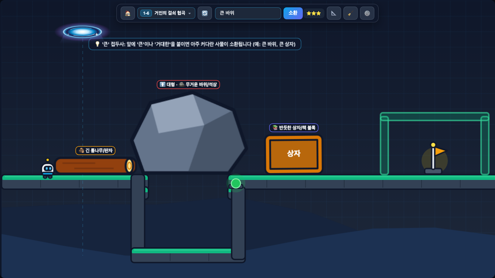
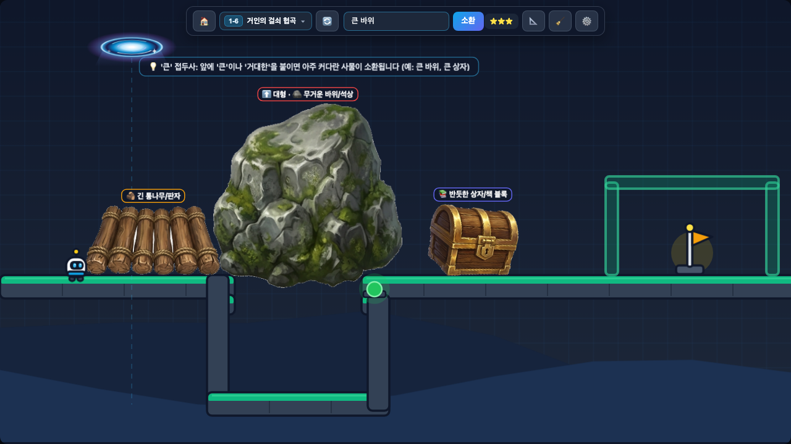

# 🌀 Something's Drop

[](#)
[](#)
[](#)
[](#)
[](#)
[](#)
[](#)
[](#)

입력한 단어를 물리 법칙이 적용된 사물로 소환하여 스테이지를 클리어하는 2D 물리 퍼즐 플랫포머 게임입니다.

단어의 의미에 따라 사물의 형태와 크기, 무게, 탄성, 마찰력, 부력, 점착성 등이 다르게 적용되며, 이를 이용해 다리를 놓거나 스위치를 누르고 장애물을 부수는 등 여러 방식으로 퍼즐을 풀 수 있습니다. 로컬 AI 서버(Ollama + Stable Diffusion)를 연결해 실시간으로 이미지를 생성하거나, 별도의 서버 없이 내장된 벡터 에셋으로 바로 플레이할 수 있습니다.

- **플레이 링크 (GitHub Pages)**: [https://gowelleast.github.io/SomethingsDrop/](https://gowelleast.github.io/SomethingsDrop/)

---

## 스크린샷

| 오프라인 모드 (내장 에셋) | 로컬 Stable Diffusion 연동 모드 |
| :---: | :---: |
|  |  |
| 내장된 프로시저럴 벡터 에셋으로 즉시 소환 | 로컬 SD 서버에서 실시간 생성된 이미지로 소환 |

---

## 주요 특징

- **단어 기반 사물 소환 및 한글 퍼지 매칭**
  - 한글 또는 영문 단어를 입력하면 해당 사물의 실루엣과 6가지 물리 특성(`normal`, `heavy`, `bouncy`, `float`, `slippery`, `sticky`)이 부여된 오브젝트가 상단 포탈에서 소환됩니다.
  - 자모 분리 및 초성 매칭(`KoreanFuzzyMatcher`)을 지원하여 오타나 초성 입력(예: `ㅋㄲㄹ` → `코끼리`)도 인식합니다.
- **크기 수식어(`큰` / `작은`) 및 클릭 회수 기믹**
  - 단어 앞에 `큰`, `거대한`, `대형` 또는 `작은`, `미니`, `초소형` 등의 접두사를 붙여 사물의 크기와 질량을 조절할 수 있습니다. (예: 좁은 구멍에 `작은 공` 넣기, 넓은 절벽에 `큰 바위` 걸치기)
  - 이미 소환한 사물을 마우스로 클릭해 제거할 수 있으며, 큰 사물로 스위치를 누른 뒤 다시 클릭해 지우고 지나가는 퍼즐 기믹에 활용됩니다.
- **이미지 외곽선 기반 정밀 폴리곤 충돌체 생성**
  - 소환된 이미지의 불투명 픽셀 영역에서 외곽선을 추출하고 다각형을 단순화하여, 보이는 이미지 모양 그대로 Matter.js 물리 충돌체를 생성합니다.
- **4개 챕터, 48개 스테이지**
  - 초원 실험실(Stage 1), 기어 공방(Stage 2), 하늘 제도(Stage 3), 사이버 연구소(Stage 4)의 4개 챕터(챕터당 12개 맵)로 구성되어 있습니다.
  - 틈새 버튼(`SlotButton`), 압력 스위치(`PressureSwitch`), 균열 블록(`CrackedBlock`), 상승/횡풍 기류(`WindZone`), 시소 지렛대(`Seesaw`), 가시 함정(`SpikeHazard`), 레이저 센서/트랩(`LaserBeam`) 등의 기믹이 조합됩니다.

---

## 로컬 AI 이미지 생성 및 게임 연동 파이프라인

게임은 실행 환경에 따라 **오프라인 모드(`Offline`)**와 **로컬 AI 연동 모드(`Auto` / `LAN AI`)**를 모두 지원합니다.

```text
[단어 입력 (예: "큰 바위", "작은 공", "트램펄린")]
   │
   ├─ 1. 수식어 및 단어 분석 (KoreanFuzzyMatcher + WordPhysicsPredictor)
   │     ├─ 크기 접두사 분리 ("큰" → giant, "작은" → tiny)
   │     └─ 내장 물성 사전(1,400+ 단어) 매칭 또는 Ollama LLM 실시간 물성/번역 추론
   │
   ├─ 2. 이미지 소스 확보 (AIService)
   │     ├─ [Offline / 서버 미연결] ──> 내장 프로시저럴 벡터 스티커 즉시 렌더링 (197종, 0ms)
   │     └─ [로컬 SD 서버 연결 시] ──> IndexedDB 캐시 확인 ➔ 미스 시 Stable Diffusion API 호출
   │
   ├─ 3. 배경 제거 및 단일 오브젝트 정제 (PolygonPhysicsBuilder)
   │     ├─ 외곽 Flood-fill 크로마키 배경 투명화 (또는 외부 U2Net 연동)
   │     ├─ 사각 아이콘 테두리 감지 시 자동 프레임 제거 (unwrapOuterFrameIfPresent)
   │     └─ 다중 파편 생성 시 중심 메인 사물 클러스터 분리 (isolatePrimaryObjectCluster)
   │
   └─ 4. 폴리곤 물리 바디 생성 및 월드 소환
         ├─ 픽셀 알파 마스크 추출 및 근접 파츠 브릿징 (bridgeBinaryGridIslands)
         ├─ Marching Squares 외곽선 추출 + Ramer-Douglas-Peucker 정점 단순화
         └─ Matter.js 다각형 바디 생성 및 무게중심(Center of Mass) 1:1 원점 정렬
```

1. **물성 추론 및 영문 프롬프트 변환 (`WordPhysicsPredictor`, `AIService`)**
   - 내장 사전에 등록된 단어는 사전 정의된 물리 수치와 1:1 영문 프롬프트로 즉시 매핑되어 불필요한 LLM 호출 시간을 생략합니다.
   - 사전에 없는 새로운 단어가 입력되면 로컬 **Ollama**(`/api/generate`)를 호출해 물리 파라미터(`scale`, `density`, `friction`, `restitution`, `gravityScale`, `trait`)와 이미지 생성용 영문 프롬프트를 JSON으로 추론합니다.
2. **실시간 이미지 생성 및 후처리 (`AIService`, `PolygonPhysicsBuilder`)**
   - 변환된 프롬프트를 로컬 **Stable Diffusion WebUI**(`/sdapi/v1/txt2img`)로 전송해 단색 흰 배경의 단일 오브젝트 이미지를 생성합니다.
   - 클라이언트 내장 Flood-fill 알고리즘(또는 선택적 U2Net 서버)으로 배경을 투명화하며, 만약 SD가 사각 카드 테두리나 주변 파편을 함께 그린 경우 자동으로 테두리와 분리된 파편을 제거하고 중앙의 핵심 사물만 남깁니다.
   - 생성된 이미지와 물성 데이터는 브라우저 `IndexedDB`(`CacheService`)에 저장되어 동일 단어 재소환 시 지연 없이 불러옵니다.
3. **폴리곤 추출 및 무게중심 보정 (`PolygonPhysicsBuilder`)**
   - 크롭된 이미지의 알파 채널에서 `marchingsquares`로 외곽선 경로를 추출하고 `simplify-js`로 꼭짓점 수를 줄인 뒤 `Matter.Bodies.fromVertices`로 물리 바디를 생성합니다.
   - 다각형 정점의 최소 좌표(`vMinX`, `vMinY`)와 Matter.js 바디의 월드 바운드를 비교해 스프라이트 `origin`을 픽셀 단위로 일치시켜, 보이는 이미지와 물리 충돌 폴리곤이 어긋나지 않도록 정렬합니다.
4. **서버 상태 감지 및 즉시 폴백**
   - Windows에서 Ollama만 백그라운드로 켜져 있고 Stable Diffusion이 꺼져 있는 경우를 대비해, SD 서버 응답 여부를 먼저 확인(회로 차단기 캐시)하여 서버가 내려가 있으면 대기 시간 없이 오프라인 벡터 에셋 모드로 즉시 전환합니다.

---

## 실행 방법 및 로컬 AI(SD + Ollama) 연결 가이드

### 1. 로컬에서 프로젝트 실행하기

```bash
# 패키지 설치 (yarn 또는 npm)
yarn install

# 개발 서버 실행 (http://localhost:5173)
yarn dev

# 프로덕션 빌드
yarn build
```

별도의 AI 서버를 켜지 않아도 기본 내장된 1,400여 개 단어 사전과 197종의 프로시저럴 벡터 스티커로 48개 스테이지 전체를 플레이할 수 있습니다.

---

### 2. 로컬 AI 서버(Stable Diffusion + Ollama) 준비

실시간 AI 이미지 생성을 연동하려면 로컬 PC(또는 동일 공유기 내부망의 다른 PC)에서 아래 옵션으로 서버를 실행합니다.

1. **Stable Diffusion WebUI (Automatic1111 / Forge) 실행**
   - API 활성화 및 CORS 허용 옵션을 포함해 실행합니다 (기본 포트 `7860`):
     ```bash
     # Windows (webui-user.bat 내 COMMANDLINE_ARGS)
     set COMMANDLINE_ARGS=--api --cors-allow-origins=* --listen
     ```
   - 빠른 인게임 소환을 위해 **SDXL Lightning / Turbo** 계열 모델(5 steps, CFG 2.0, `DPM++ SDE Karras`) 사용을 권장합니다.
2. **Ollama 실행 (사전에 없는 단어 추론용)**
   - 외부 오리진 허용 환경변수를 설정해 실행합니다 (기본 포트 `11434`):
     ```bash
     # Windows PowerShell
     $env:OLLAMA_HOST="0.0.0.0:11434"
     $env:OLLAMA_ORIGINS="*"
     ollama serve
     ```
   - 가벼운 모델(예: `ollama pull gemma4:e4b` 또는 `gemma2:2b`, `llama3.2:3b`)을 설치해 두면 게임 내 설정 모달에서 `연결 테스트` 클릭 시 설치된 모델을 자동으로 감지합니다.

---

### 3. 접속 환경별 AI 서버 연결 방법 (`localhost` vs `github.io` 배포 링크)

브라우저 보안 정책(**Mixed Content** 및 **PNA: Private Network Access**)에 따라, 로컬 개발 서버(`http://localhost:5173`)로 접속할 때와 배포된 GitHub Pages(`https://gowelleast.github.io/SomethingsDrop/`)로 접속할 때의 연결 방식에 차이가 있습니다.

#### A. 로컬 개발 서버(`http://localhost:5173`)로 실행하는 경우 (권장)
`http://localhost:5173`은 로컬 HTTP 환경이므로, **같은 PC(`127.0.0.1`)**뿐만 아니라 **같은 공유기 내부망에 있는 다른 Windows PC(`http://192.168.x.x`)**의 SD/Ollama 서버에도 브라우저 차단 없이 바로 연결됩니다.

- 게임 우측 상단 **`⚙️ 설정`** 버튼을 눌러 서버 주소를 입력하거나, 프로젝트 루트에 `.env.local` 파일을 만들어 기본 주소를 지정할 수 있습니다 (`.env.local`은 `.gitignore`에 의해 Git 커밋에서 제외됩니다):
  ```env
  VITE_OLLAMA_URL=http://192.168.0.x:11434
  VITE_OLLAMA_MODEL=gemma4:e4b
  VITE_SD_URL=http://192.168.0.x:7860
  ```

#### B. 배포된 링크(`https://gowelleast.github.io/SomethingsDrop/`)에서 플레이하는 경우
GitHub Pages는 **공인 HTTPS(`https://`)** 웹페이지이기 때문에, 최신 브라우저 보안 정책상 암호화되지 않은 내부망 사설 IP(`http://192.168.x.x`)로 직접 요청을 보내면 **PNA(Private Network Access) 및 혼합 콘텐츠 차단**이 발생합니다. 배포 링크에서 로컬 AI를 연결하려면 아래 두 가지 방법 중 하나를 사용합니다.

1. **SD/Ollama가 실행 중인 동일한 PC에서 브라우저로 접속하는 경우**
   - 브라우저 표준상 루프백 주소(`http://127.0.0.1`)는 안전한 컨텍스트로 예외 허용됩니다.
   - SD(`--api --cors-allow-origins=*`)와 Ollama(`OLLAMA_ORIGINS=*`)를 실행한 같은 PC에서 배포 링크에 접속하면 기본 주소(`http://127.0.0.1:7860`, `http://127.0.0.1:11434`)로 연결할 수 있습니다.
2. **다른 기기(예: MacBook)에서 배포 링크에 접속해 내부망 Windows PC(`192.168.x.x`)의 SD/Ollama를 연결하려는 경우**
   - `https://` 배포 페이지에서 다른 기기로 요청하려면 대상 서버 주소도 `https://`여야 브라우저 PNA 차단을 우회할 수 있습니다.
   - Windows PC에서 **Cloudflare Tunnel (`cloudflared`)** 또는 **ngrok** 등으로 로컬 포트를 HTTPS 주소로 포워딩한 뒤, 생성된 `https://xxxx.trycloudflare.com` 주소를 게임 내 **`⚙️ 설정`** 모달에 입력하면 배포 링크에서도 정상 연결됩니다:
     ```bash
     # Windows PC에서 Cloudflare Tunnel 실행 예시 (무료, 설치 후 바로 실행 가능)
     cloudflared tunnel --url http://127.0.0.1:7860
     cloudflared tunnel --url http://127.0.0.1:11434
     ```
   - 별도 터널 설정 없이 내부망 IP(`http://192.168.x.x`)로 바로 연결하고 싶다면 **A 방식(`yarn dev` 로컬 실행)**을 사용하는 것이 가장 간편합니다.

---

## 사용 기술 및 라이브러리

- **Language & Bundler**: TypeScript (`~5.7.2`), Vite (`^6.3.3`)
- **Game Engine & Physics**: Phaser 3 (`^3.88.2`), Matter.js (Phaser 내장 2D 강체 물리 엔진)
- **Polygon Extraction**:
  - `marchingsquares` (`^1.3.3`): 이미지 알파 채널 기반 외곽선 등고선(Iso-contour) 추출
  - `simplify-js` (`^1.2.4`): Ramer-Douglas-Peucker 알고리즘 기반 다각형 정점 단순화
- **Storage & Caching**: Web Storage (`localStorage`), IndexedDB (`CacheService`)
- **Local AI Integration (선택 사항)**:
  - Ollama REST API (`/api/generate`, `/api/tags`)
  - Stable Diffusion WebUI REST API (`/sdapi/v1/txt2img`, `/sdapi/v1/options`)

---

## 프로젝트 구조

```text
SomethingsDrop/
├── .github/
│   └── workflows/
│       └── deploy.yml                  # GitHub Pages 자동 빌드 및 배포 워크플로우
├── docs/
│   └── screenshots/                    # README용 오프라인 / 로컬 SD 비교 스크린샷
├── public/
│   └── assets/
│       └── audio/                      # BGM 및 효과음 리소스
├── src/
│   ├── art/
│   │   ├── GameArtGenerator.ts         # 캐릭터, 지형, 배경, 기믹 텍스처 프로시저럴 생성
│   │   └── ProceduralStickerArtist.ts  # 오프라인 모드용 197종 벡터 스티커 렌더러
│   ├── config/
│   │   └── settings.ts                 # 설정/별점 저장소 및 URL/입력값 보안 검증
│   ├── levels/
│   │   ├── LevelTypes.ts               # 스테이지 및 퍼즐 기믹 데이터 타입 정의
│   │   └── stages.ts                   # 4개 챕터, 48개 스테이지 레벨 데이터
│   ├── objects/
│   │   ├── Player.ts                   # 플레이어 이동, 점프, 코요테 타임 및 물성 반응 제어
│   │   ├── PortalCursor.ts             # 상단 소환 포탈 조준 및 고정 제어
│   │   └── gimmicks/                   # 스위치, 틈새 버튼, 균열 블록, 바람, 시소, 가시, 레이저
│   ├── physics/
│   │   ├── PolygonPhysicsBuilder.ts    # 배경 제거, 단일 사물 클러스터 분리, 외곽선 추출 및 바디 생성
│   │   └── SpawnedObject.ts            # 소환된 사물의 특성(Trait) 물리 동작 및 클릭 제거 처리
│   ├── scenes/
│   │   ├── TitleScene.ts               # 타이틀 화면 (물리 데모 낙하 연출 및 챕터 선택)
│   │   └── GameScene.ts                # 메인 게임 루프, 물리 충돌 및 스테이지 클리어 처리
│   ├── services/
│   │   ├── AIService.ts                # Ollama / Stable Diffusion API 연동 및 오프라인 폴백
│   │   ├── CacheService.ts             # 생성된 이미지 및 물성 IndexedDB 캐싱
│   │   ├── KoreanFuzzyMatcher.ts       # 한글 자모 분리, 초성 매칭, 크기 접두사 추출
│   │   └── WordPhysicsPredictor.ts     # 내장 단어 사전(1,400+ 단어) 및 물성 추론
│   ├── types/                          # 외부 모듈 및 Matter.js 타입 선언
│   ├── ui/
│   │   └── HudOverlay.ts               # 상단 HUD, 챕터 탭 스테이지 선택 모달, AI 서버 설정 모달
│   ├── index.html
│   ├── index.ts
│   └── reset.css
├── package.json
├── tsconfig.json
└── vite.config.ts
```

---

## 조작 방법

| 입력 | 동작 |
| :---: | :--- |
| `A` / `D` 또는 `←` / `→` | 좌우 이동 |
| `W` / `Space` / `↑` | 점프 |
| `마우스 이동` | 상단 소환 포탈 위치 지정 (캐릭터가 이동하기 전까지 해당 위치 유지) |
| `Enter` | 단어 입력창 포커스 / 입력한 단어 소환 |
| `소환된 사물 클릭` | 해당 사물 월드에서 제거 (회수) |
| `🔄 버튼` | 현재 스테이지 즉시 재시작 |
| `🧹 버튼` | 소환된 모든 사물 일괄 제거 |
| `F2` (또는 `📐 버튼`) | 물리 충돌 다각형(디버그 와이어프레임) 표시 토글 |
| `ESC` | 열려 있는 모달 닫기 |
